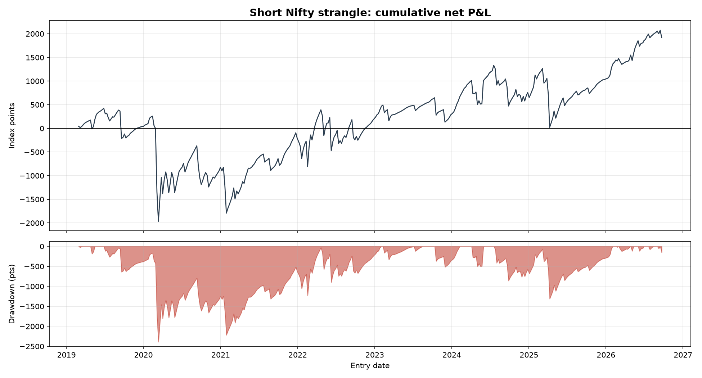
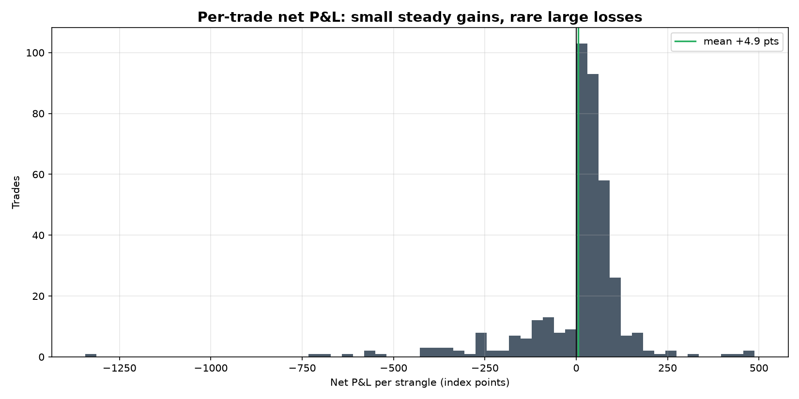

# Does Selling Nifty Weekly Strangles Pay?

Selling index options collects a premium that is usually larger than the move
that follows. This study asks two questions about that trade on Nifty weekly
options, 2019–2026: **does the premium survive real costs**, and **what does
the loss tail actually look like**?

Short answer: the edge is real and clears costs by a wide margin, but a single
week in March 2020 lost 1,344 points — about 40 weeks of median profit — and
the strategy did not make a new equity high for **43 months** afterwards. At
one lot per ₹1.5 lakh of margin, the drawdown is larger than the margin
itself.

## Results

391 weekly trades, sell a 2% out-of-the-money call and put at the previous
expiry's close, hold to settlement.

| | |
|---|---|
| Mean premium sold | 75.43 points |
| Mean gross P&L | +6.37 points |
| Mean cost (brokerage, STT, exchange, GST, slippage) | 1.46 points (3.4% of premium) |
| **Mean net P&L** | **+4.91 points** |
| Net edge as a share of premium | +6.51% |
| Costs the edge could absorb before breaking even | 4.35× |
| Slippage per leg that would erase the edge | 2.70 points |

And the part that decides whether it is investable:

| | |
|---|---|
| Win rate | 78.0% |
| Median trade | +33.26 points |
| Skew | **−2.92** |
| Excess kurtosis | **+18.04** |
| Best trade | +488 points |
| Worst trade | **−1,344 points** (week of 5 Mar 2020) |
| Max drawdown | −2,389 points |

Three quarters of weeks keep most of the premium, the median trade is six times
the mean, and the distribution is sharply left-tailed. That is the short-volatility
shape: get paid steadily, then pay it back at once.

The timing is the uncomfortable part. Cumulative P&L peaked at +424 points in
June 2019, was back to zero by early March 2020 before the crash week even
arrived, bottomed at −1,965, and did not regain the 2019 peak until **February
2023** — 43 months later.





### Year by year

| Year | Trades | Net points | Win rate | Worst trade |
|---|---|---|---|---|
| 2019 | 44 | +37.8 | 79.5% | −578 |
| 2020 | 53 | **−861.9** | 69.8% | **−1,344** |
| 2021 | 52 | +609.5 | 78.8% | −580 |
| 2022 | 52 | +417.0 | 73.1% | −703 |
| 2023 | 49 | +87.0 | 89.8% | −369 |
| 2024 | 52 | +468.0 | 75.0% | −407 |
| 2025 | 53 | +285.7 | 83.0% | −688 |
| 2026 | 36 | +875.8 | 75.0% | −156 |

Seven of eight years are profitable. The eighth contains the COVID crash, and
loses more than 2019, 2023 and 2025 made combined. A study run on 2023 alone —
one calm year, 89.8% win rate, no loss worse than 369 points — would have
concluded the strategy was safe.

### On a capital base

| | |
|---|---|
| Margin assumed per lot | ₹1,50,000 |
| Annualized return | +9.05% |
| Annualized Sharpe | 0.18 |
| Total P&L per lot | +₹1,02,116 |
| **Max drawdown** | **−119.4%** |

A drawdown larger than the margin means the account is gone before the
recovery arrives. Note that **every figure in this table scales with the
margin assumption** — it is an input, not a result, which is exactly why the
point-denominated tables come first.

## Method

- **Entry** at the close of expiry *i*, selling the options expiring at *i+1* —
  so roughly 7 days to expiry, read from the data rather than assumed.
- **Exit** at NSE's official settlement. Index options are cash settled, so
  each short leg pays its intrinsic value against the settlement level. **No
  intraday fill is ever assumed**, which is the main reason to prefer
  held-to-expiry over an intraday rule.
- **Strikes** 2% either side of the forward, which is derived from put-call
  parity (`F = K + (C − P)`) rather than the futures close: parity gives the
  forward for the option's own expiry, needs no rate assumption, and works in
  both bhavcopy formats.
- **Costs** are modelled per component — ₹20 per order brokerage, STT on
  premium sold (0.0625%, rising to 0.1% from 1 Oct 2024), exchange charges,
  SEBI fee, 18% GST, and slippage. Held to expiry there is no exit brokerage
  and no exercise STT, which falls on the option buyer.
- **The unit of analysis is the position, not the leg.** A strangle is one
  trade with one payoff. The study reports both (−2.92 per position, −4.80 per
  leg) rather than picking the flattering one.

## Data

NSE publishes the full F&O bhavcopy daily, free and without login. The study
downloads only the dates it needs — one file per expiry — and caches them.

The file layout changed in 2024, so two formats are handled. Two wrinkles are
worth knowing, because both would quietly corrupt results:

1. **Untraded strikes carry a stale previous close.** Treating those as
   executable manufactures fills that were never available, so rows with zero
   volume or zero open interest are dropped.
2. **On expiry day, the settlement-price column holds the *index* settlement
   level**, repeated on every expiring row — not the option's own value. It is
   read as the settlement level and each leg's payoff computed from it.

Pre-2024 files also omit the contract lot size, but they report turnover as
notional, so lot size is recovered as `turnover / (volume × index level)` and
snapped to a lot size NSE actually used. That returns 75 for 2019–21, 50 for
2022–23 and 25 for 2024, matching the published values.

## Reproduce

```bash
python3 -m venv venv
source venv/bin/activate
pip install -r requirements.txt

# Download the bhavcopy for every expiry date (~480 files, a few minutes).
# Cached under data/raw/, so later runs are instant.
PYTHONPATH=src python src/bhavcopy.py 2019-01-01 2026-10-01

# Build the trades, price the costs, print every table above, save figures.
PYTHONPATH=src python src/study.py 2019-01-01 2026-10-01

# Tests (synthetic data, no network)
PYTHONPATH=src pytest -q
```

Useful variations:

```bash
PYTHONPATH=src python src/study.py --otm-pct 0.01    # closer strikes
PYTHONPATH=src python src/study.py --slippage 1.0    # harsher fills
```

## Layout

```
src/bhavcopy.py     NSE download, both file formats, lot-size recovery
src/blackscholes.py Black-76 pricing, implied vol by Newton-Raphson
src/strangle.py     forward from parity, strike selection, trade construction
src/costs.py        Indian cost stack, breakeven multiple and slippage
src/stats.py        distribution and drawdown statistics
src/plots.py        equity curve, P&L distribution, implied vs realized move
src/study.py        runs everything
tests/              22 tests on synthetic data
```

## Limitations

- **Daily data, so one entry rule.** Free NSE data is end-of-day, so entry is
  at the close. Intraday variants (entry times, stop-losses) need 1-minute
  data, which is not freely available. Held-to-expiry avoids fill assumptions,
  but it cannot test whether an intraday stop would help.
- **The 2% strike distance and weekly horizon were chosen, not validated.**
  There is no walk-forward over the parameters, so treat the exact numbers as
  one point on a surface, not an optimum.
- **Margin is an assumption.** ₹1.5 lakh per lot is indicative; real SPAN
  margin moves with volatility, and it rises exactly when the strategy is
  losing — so the true drawdown is likely worse than reported here.
- **No position sizing or risk management.** One lot per expiry, always on.
  A real implementation would size on volatility and probably not sell during
  a crash, which is both the obvious improvement and the hardest to backtest
  honestly.
- **The forward comes from closing prices** on both legs, which are not
  simultaneous trades. This affects strike selection and reported implied vol
  slightly, not the settlement-based P&L.
- **Eight years, one crash.** The tail estimate rests largely on March 2020.
  Skew of −2.92 is a measurement of this sample, not a stable constant.

## Credit

The question came from [Sankarshan03/Strandle_BankNifty](https://github.com/Sankarshan03/Strandle_BankNifty),
an intraday BankNifty short-strangle backtest on 1-minute data. This study
takes a different route — daily data, held to expiry, Nifty weeklies, with
costs and the tail as the subject rather than a footnote. No data from that
repository is used or redistributed here.
